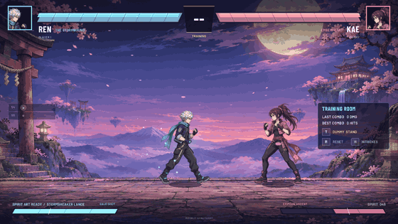
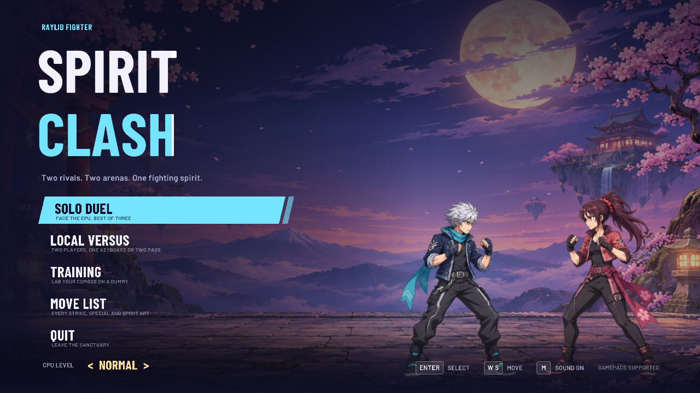
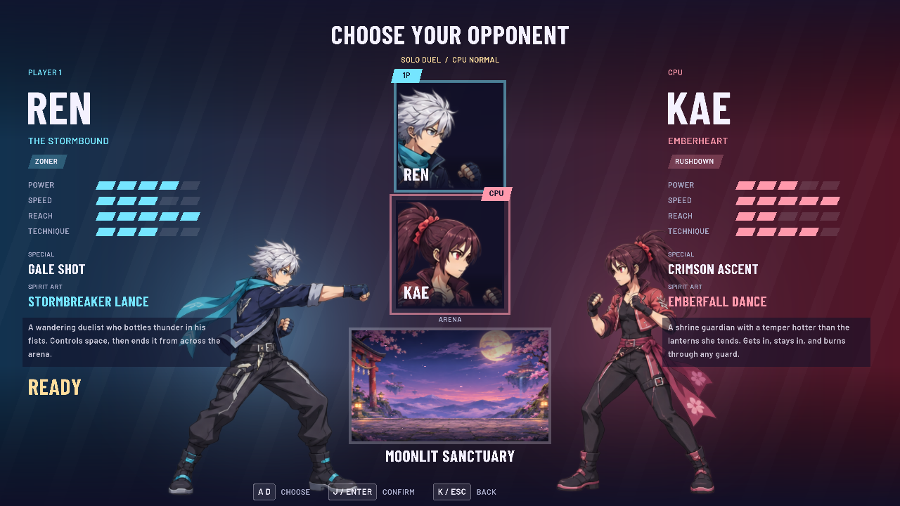
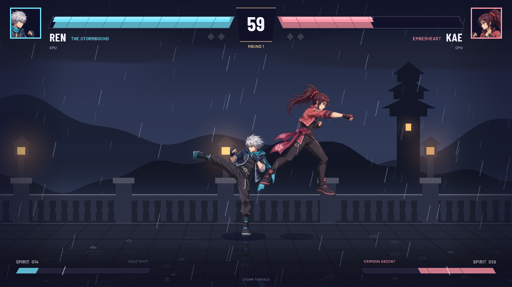
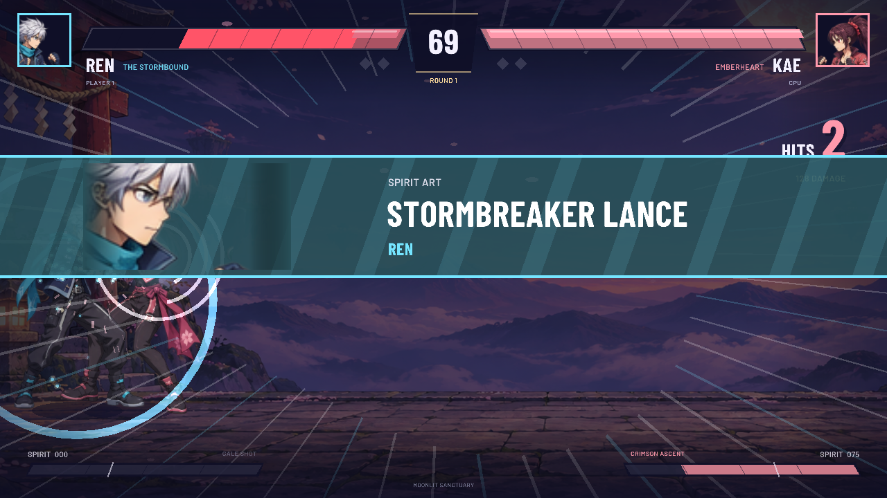
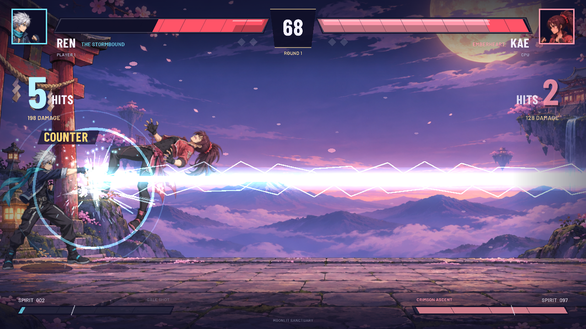
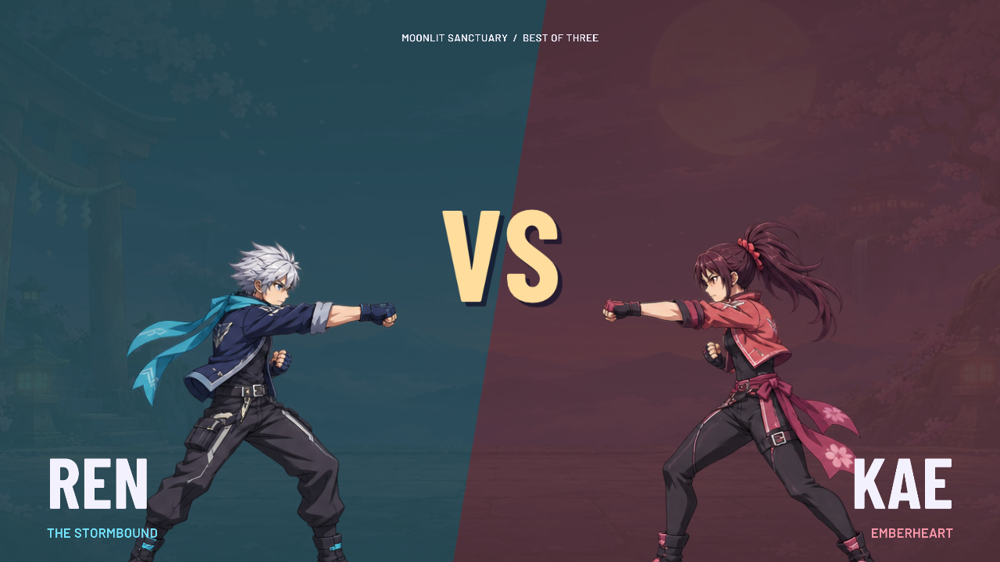
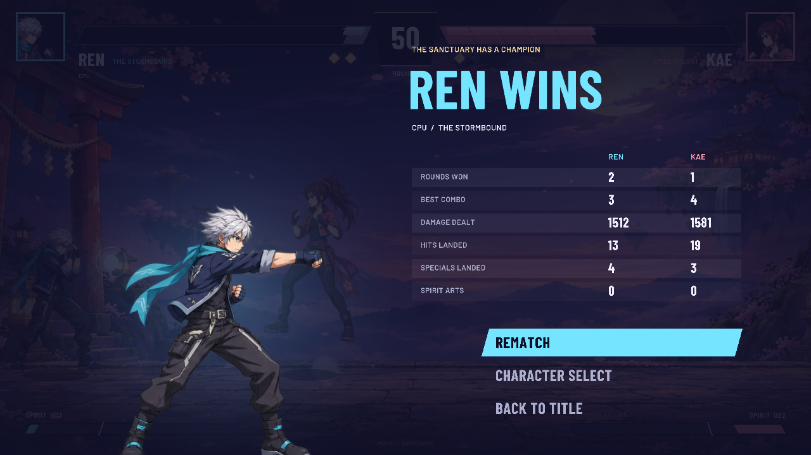
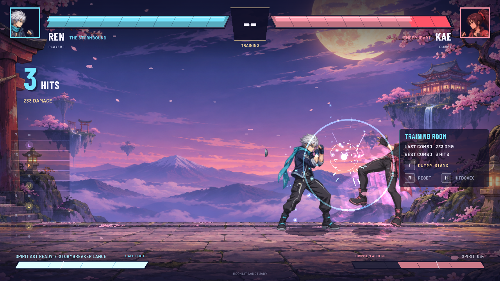

# Spirit Clash · raylib fighter

An anime-inspired 2D arena fighter written in **C17 + raylib**. Pick Ren or Kae, choose an arena, and fight a best-of-three with chain combos, juggles, wall bounces, guard breaks and screen-freezing Spirit Arts. Everything you see and hear is original: the fighters and the Moonlit Sanctuary are bespoke art, while the Storm Terrace arena, every sound effect and both music tracks are generated in code.





## What's in the box

**Modes**
- **Solo duel** against a reaction-based CPU on Easy, Normal or Hard.
- **Local versus** for two players on one keyboard, or two gamepads.
- **Training room** with infinite spirit, a live input history, combo damage readout, hitbox view and a dummy that can stand, guard, jump or fight back.
- **Move list** reachable from the title screen and from pause.

**Fighters**

| | Ren, The Stormbound | Kae, Emberheart |
| --- | --- | --- |
| Style | Zoner: controls space | Rushdown: gets in and stays in |
| Special (35 spirit) | **Gale Shot**: a spinning wind orb that clashes with other shots | **Crimson Ascent**: an invulnerable rising uppercut that beats jump-ins and launches |
| Spirit Art (100 spirit) | **Stormbreaker Lance**: a screen-long lightning beam, nine hits | **Emberfall Dance**: an invulnerable rush into a nine-hit flurry and a launcher |

Mirror matches give player two an alternate palette.

**Arenas**
- **Moonlit Sanctuary**: the painted shrine, now with parallax, flickering lanterns and drifting petals.
- **Storm Terrace**: a procedural cliff-top terrace in a thunderstorm, with layered rain, lightning strikes and thunder, flickering lantern light and fighters reflected in the wet stone.



## Combat

- **Chain cancels:** strike › strike › strike › heavy › special › Spirit Art. Chained attacks lurch forward so links survive pushback, and combo damage scales down the longer a combo runs.
- **Launchers and juggles:** a heavy that ends a chain launches, and any hit on an airborne opponent juggles them, with decaying lift. A launched fighter bounces off a wall once, then lands in a knockdown with wake-up invulnerability.
- **Counter-hits:** hitting someone during their own attack deals +20% damage, and a heavy counter-hit launches.
- **Guard:** guarding is directional. Each blocked hit costs 7 spirit, and guarding with an empty gauge causes a **Guard Break**.
- **Movement:** dash, plus an invulnerable backdash that keeps your facing. In the air there's a sky jab and a dive kick that bounces off on hit.
- **Spirit Arts** freeze time with a cut-in banner, radial speed lines and a darkened arena before they fire.
- **Input buffering:** presses buffer for 140 ms, including through hitstop, so you can mash through impact freezes.



## Game feel

The presentation layer in `src/engine/fx.c` reacts to events published by the simulation:

- trauma-based camera shake
- a follow camera that zooms in as the fighters close distance
- zoom punches toward impacts
- KO slow motion that eases back to full speed
- hitstop with the victim shuddering and flashing
- impact stars, spark streaks, embers, shockwave rings, dust and glass shards
- afterimage trails on dashes, dives, launches and supers
- COUNTER, GUARD BREAK and WALL BOUNCE popups
- a combo counter with damage

The announcer handles ROUND, FINAL ROUND, CLASH!, K.O., TIME, DOUBLE K.O. and PERFECT.

| Spirit Art cut-in | Stormbreaker Lance |
| --- | --- |
|  |  |

## The CPU

`src/ai.c` plays the way a person does. It perceives the situation, schedules a response after a reaction delay that depends on difficulty, and then:

- anti-airs jump-ins
- jumps, counter-fires or guards against projectiles
- reads pressure, guards on wake-up and reverses with invulnerable moves
- punishes whiffs and blocked heavies, but only when the attacker can't cancel
- confirms hits into full combos and chases juggles
- plays to its character's range: Ren zones, Kae rushes

Against a frame-perfect "walk in and mash chains" bot, the CPU wins about **5% on Easy, 50% on Normal and 90% on Hard**.

## Controls

| Action | Player 1 | Player 2 | Gamepad |
| --- | --- | --- | --- |
| Move | A / D | Left / Right | D-pad or left stick |
| Jump | W | Up | A |
| Guard (hold) | S | Down | LB or down |
| Strike | J | , or Numpad 1 | X |
| Heavy kick | K | . or Numpad 2 | Y |
| Special | L | / or Numpad 3 | B |
| Spirit Art | I, or K+L together | ; or Numpad 4 | RT |
| Dash / backdash | Space (hold back to backdash) | Right Shift or Numpad 0 | RB |

**Esc** or **Start** pauses and **Enter** selects. **F10** toggles fullscreen, **M** mutes, **V** turns on calm camera (no shake, zoom or flashes) and **H** shows hitboxes. **F9** saves a screenshot to `screenshots/` beside the executable. In training, **T** cycles the dummy and **R** resets positions. On the title screen, Left and Right change the CPU difficulty and **Q** quits.

## Build and run

On Arch Linux:

```sh
sudo pacman -S --needed cmake gcc git pkgconf wayland wayland-protocols libxkbcommon mesa
git clone https://github.com/yadavayush834/raylib-fighter.git
cd raylib-fighter
./scripts/run.sh
```

CMake uses an installed raylib 6.x if it finds one, and otherwise downloads raylib 6.2 on the first build (after that it works offline). On Wayland desktops such as Hyprland it builds a native Wayland backend automatically. Use `-DSPIRIT_NATIVE_WAYLAND=OFF` for an X11 build, which needs the X11/OpenGL development packages. The game renders at the framebuffer's real pixel density, so text stays sharp under fractional scaling.

Run `./scripts/install-desktop.sh` to add **Spirit Clash** to your app launcher.

## Development

```sh
cmake -S . -B build -DCMAKE_BUILD_TYPE=Release
cmake --build build --parallel 4
ctest --test-dir build --output-on-failure        # 23 combat and AI regression checks
./build/spirit-clash --demo                       # CPU vs CPU exhibition (add --stage storm)
```

**Play-tests.** The engine's input layer can replay a timed key script, so the whole game (menus, select, VS, fights, pause, training) can be driven end to end without a person:

```sh
./build/spirit-clash --script tests/playtest/solo.txt --snap-dir /tmp/snaps
```

Scripts are lines of `<seconds> tap|down|up <KEY>`, `<seconds> snap <name>` and `<seconds> quit`. Configure with `-DSPIRIT_PLAYTESTS=ON` to run the solo, training and versus scripts through CTest; they need a display.

**Captures.** `--capture FILE --scene menu|select|versus|fight|super|hurt|pause|results|moves [--stage storm] --frames N` renders a deterministic frame for docs and visual checks.

### Layout

| Path | Role |
| --- | --- |
| `src/combat.c` | Deterministic 120 Hz simulation: frame data, cancels, juggles, guard, supers, rounds, roster data |
| `src/ai.c` | Reaction-time CPU opponent |
| `src/engine/fx.c` | Camera, shake, slow motion, particles, rings, streaks, afterimages, popups |
| `src/engine/input.c` | Keyboard and gamepad mapping, menu input, input history, script replay |
| `src/render.c` | Sprite pose machine, reflections, beams, projectiles, world compositing |
| `src/stage.c` | Moonlit Sanctuary parallax and the procedural Storm Terrace |
| `src/ui.c` | HUD, announcer, Spirit Art cut-in, title, select, VS, pause, move list, results |
| `src/audio.c` | Procedural SFX synthesis and streamed procedural music |
| `main.c` | Scene flow, fixed-step loop, capture and replay plumbing |

| Versus splash | Results | Training room |
| --- | --- | --- |
|  |  |  |

See [art, font and engine credits](assets/CREDITS.md).
