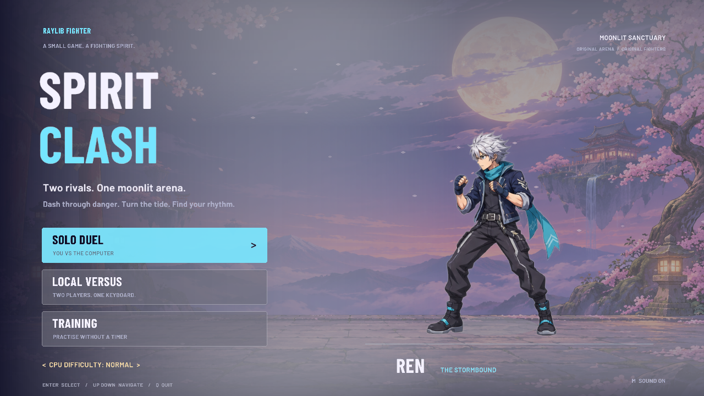
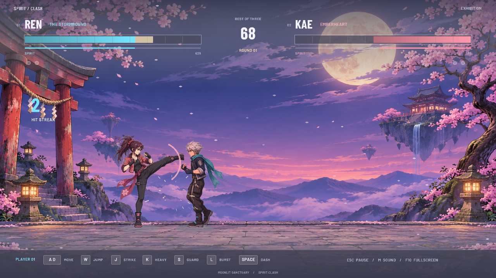

# Spirit Clash · raylib fighter

An anime-inspired 2D arena fighter built in **C17 + raylib**. Ren and Kae face off in the Moonlit Sanctuary, with fast dashes, aerial strikes, spirit bursts, and a best-of-three duel.



## Play

- **Solo duel** against a computer opponent with Easy, Normal, and Hard difficulty.
- **Local versus** for two players on one keyboard.
- **Training** with unlimited spirit and a recovering sparring partner.
- Animated character poses, hit sparks, projectile clashes, guard effects, and synthesized sound.
- Fixed-step combat, short input buffering, directional guard, dash invulnerability, and single-hit attack windows.



## Build and run

On Arch Linux, install the build tools and raylib once:

```sh
sudo pacman -S --needed raylib cmake gcc
git clone https://github.com/yadavayush834/raylib-fighter.git
cd raylib-fighter
./scripts/run.sh
```

CMake also supports other desktop platforms and fetches raylib 6.2 if an installed 6.x version is unavailable. Linux source builds need the usual X11/OpenGL development packages. Once built, the game and all assets work offline.

Run `./scripts/install-desktop.sh` on Linux to add **Spirit Clash** to your app launcher.

## Controls

| Action | Player 1 | Player 2 |
| --- | --- | --- |
| Move | A / D | Left / Right |
| Jump | W | Up |
| Light strike | J | Comma or Numpad 1 |
| Heavy kick | K | Period or Numpad 2 |
| Guard | Hold S | Hold Down |
| Spirit burst | L | Slash or Numpad 3 |
| Dash | Space | Right Shift or Numpad 0 |

**Enter** selects a menu item. **Esc** pauses. **F10** toggles fullscreen, **M** mutes, **V** reduces camera/ambient motion, and **H** shows hitboxes. **F12** saves a screenshot beside the executable in `screenshots/`. On the title screen, Left/Right changes CPU difficulty and **Q** exits.

## Development

```sh
cmake -S . -B build -DCMAKE_BUILD_TYPE=Release
cmake --build build --parallel 4
ctest --test-dir build --output-on-failure
./build/spirit-clash --demo
```

The combat suite covers attack timing, guard, whiffs, movement, resource costs, projectiles, pause, rounds, training, buffered input, and deterministic AI. Render captures use `--capture file.png --scene fight --frames 600`. The game currently has one arena and two fighters. See [art, font, and engine credits](assets/CREDITS.md).
